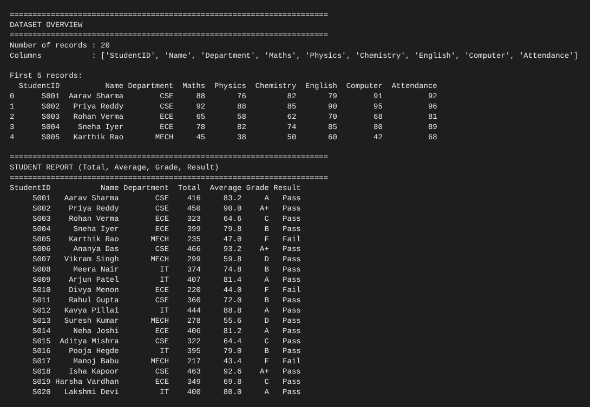
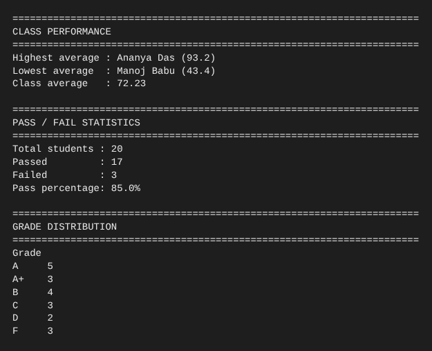
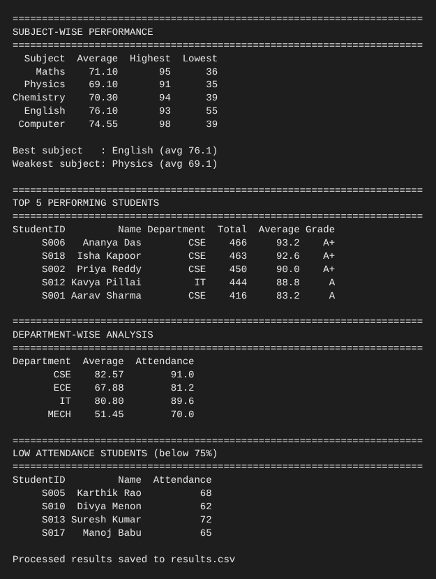

# Student Performance Analytics System

**Python Project Assignment – EWB Courses | Python with AI**

## 1. Project Title and Student Details

- **Project:** Student Performance Analytics System
- **Name:** Manda Akshaya Sri
- **Email:** akshayasrimanda@gmail.com
- **Course:** Python with AI (EWB Courses)

## 2. Objective

Teachers often need to calculate totals, averages, grades and pass/fail status for every student by hand, which is slow and error-prone. This project automates that: it reads student records from a CSV file, processes them with NumPy and Pandas, and prints a clear performance report (grades, pass/fail statistics, subject-wise analysis and top performers).

## 3. Technologies Used

- Python 3
- NumPy – numerical calculations (totals, averages, min/max)
- Pandas – loading the CSV, DataFrame operations, filtering, grouping, sorting

## 4. Dataset Description

`students.csv` has **20 student records** with these columns:

| Column | Description |
|---|---|
| StudentID | Unique ID (S001–S020) |
| Name | Student name |
| Department | CSE, ECE, IT or MECH |
| Maths, Physics, Chemistry, English, Computer | Subject marks out of 100 |
| Attendance | Attendance percentage |

## 5. Implementation

1. **Load data** – `load_data()` reads `students.csv` into a Pandas DataFrame; the program shows the record count, columns and first 5 rows.
2. **Total and average** – `calculate_total_and_average()` converts the subject marks to a NumPy 2D array and uses `np.sum` and `np.mean` along each row.
3. **Grades** – `assign_grades()` loops over each average and calls `get_grade()`:

   | Average | Grade |
   |---|---|
   | 90 and above | A+ |
   | 80 – 89 | A |
   | 70 – 79 | B |
   | 60 – 69 | C |
   | 50 – 59 | D |
   | below 50 | F |

4. **Pass/Fail** – `assign_pass_fail()` loops over the students; a student **passes only if every subject mark is 40 or more**, otherwise fails.
5. **Analysis** – functions compute highest/lowest/class average, pass percentage, subject-wise statistics, top 5 students, department-wise averages and low-attendance students (below 75%).
6. **Output** – `main.py` prints all results in readable sections and saves the processed data to `results.csv`.

## 6. Key Features

| Function (in `functions.py`) | Purpose |
|---|---|
| `load_data` | Read CSV into a DataFrame |
| `calculate_total_and_average` | Total and average marks using NumPy |
| `get_grade` / `assign_grades` | Grading rule applied with a loop |
| `assign_pass_fail` | Pass/fail using a clear condition |
| `class_statistics` | Highest, lowest and class average |
| `pass_fail_statistics` | Passed, failed, pass percentage |
| `subject_analysis` | Average, highest, lowest per subject |
| `top_performers` | Top N students by average |
| `department_analysis` | Department-wise average and attendance |
| `low_attendance_students` | Students with attendance below 75% |

### How to Run

```bash
pip install numpy pandas
python main.py
```

Files: `main.py` (runs the analysis), `functions.py` (reusable functions), `students.csv` (dataset), `results.csv` (generated output).

## 7. Output / Screenshots

Actual results from running the project:

```
CLASS PERFORMANCE
Highest average : Ananya Das (93.2)
Lowest average  : Manoj Babu (43.4)
Class average   : 72.23

PASS / FAIL STATISTICS
Total students : 20
Passed         : 17
Failed         : 3
Pass percentage: 85.0%

GRADE DISTRIBUTION
A+ 3 | A 5 | B 4 | C 3 | D 2 | F 3

SUBJECT-WISE PERFORMANCE
  Subject  Average  Highest  Lowest
    Maths    71.10       95      36
  Physics    69.10       91      35
Chemistry    70.30       94      39
  English    76.10       93      55
 Computer    74.55       98      39

Best subject   : English (avg 76.1)
Weakest subject: Physics (avg 69.1)

TOP 5 PERFORMING STUDENTS
S006  Ananya Das    CSE  466  93.2  A+
S018  Isha Kapoor   CSE  463  92.6  A+
S002  Priya Reddy   CSE  450  90.0  A+
S012  Kavya Pillai  IT   444  88.8  A
S001  Aarav Sharma  CSE  416  83.2  A

DEPARTMENT-WISE ANALYSIS
CSE  avg 82.57  attendance 91.0
ECE  avg 67.88  attendance 81.2
IT   avg 80.80  attendance 89.6
MECH avg 51.45  attendance 70.0

LOW ATTENDANCE (below 75%): S005 Karthik Rao (68), S010 Divya Menon (62),
S013 Suresh Kumar (72), S017 Manoj Babu (65)
```

### Screenshots







## 8. Final Outcome

The system successfully loads the dataset, calculates totals, averages, grades and pass/fail status for all 20 students, and produces useful insights: 17 of 20 students passed (85%), the class average is 72.23, English is the strongest subject and Physics the weakest, CSE is the best-performing department, and the MECH department has both the lowest marks and lowest attendance.

## 9. Challenges & Learning

- **Challenge:** Deciding the pass rule. I chose "at least 40 in every subject" so a student cannot pass by scoring high in one subject only.
- **Challenge:** Keeping the code organised. Moving calculations into `functions.py` made `main.py` short and easy to read.
- **Learning:** NumPy makes row-wise calculations (sum, mean) simple; Pandas makes sorting, grouping and filtering easy; separating logic into reusable functions improves readability.
- **Learning:** Using Git and GitHub to publish and document a project.

## 10. GitHub Repository

Repository link: https://github.com/Akshayasri18/student-performance-analytics
